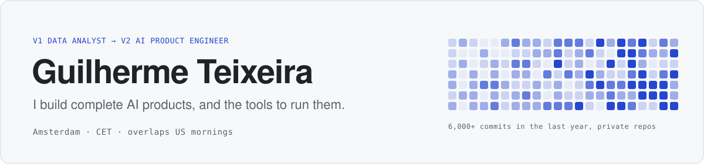
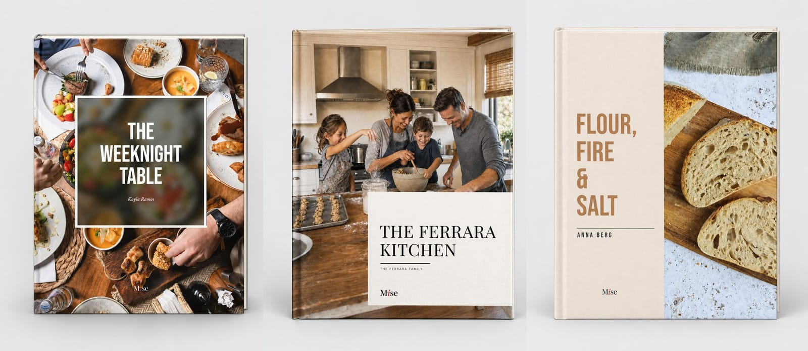
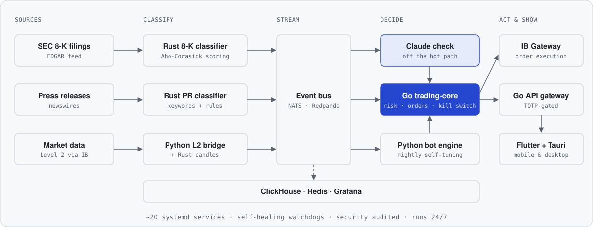
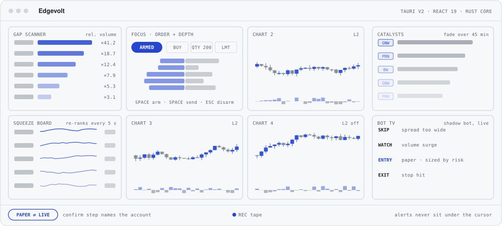
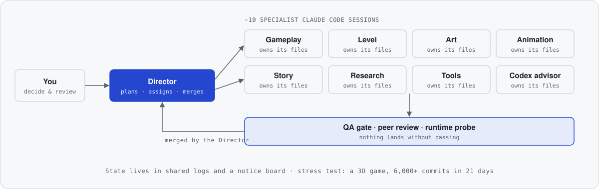

<picture>
  <source media="(prefers-color-scheme: dark)" srcset="assets/header-dark.svg">
  
</picture>

### I build complete products with AI, from backend and UI to payments, infrastructure and the dashboards that run the business.

I spent six years in data at **PastBook**, **Tesla** and **Just Eat Takeaway**, and I hold an MSc in Data Science. That taught me to start from the numbers: who uses the product, what it earns and where it breaks. Today I use AI coding agents to turn that thinking into production software. I design the architecture, set the rules the agents work by, and test what ships.

> [!NOTE]
> My product code is private because these products are businesses. The contribution graph below is real work in those private repos. I'm happy to walk you through any of it on a call.

---

## Selected work

### Mise · print-on-demand cookbook platform

Families turn their recipe collections into a professionally printed hardcover cookbook. They can paste text, paste a link or photograph a handwritten card.

- **AI recipe import:** Gemini reads text, web pages and photos of handwritten cards into structured recipes
- **Live 3D book designer** in React Three Fiber, plus a **300-DPI CMYK print pipeline**; one template spec drives both
- **Commerce:** Stripe, Supabase, live shipping quotes from the print partner's API, PostHog, Resend
- **Mise HQ:** an operator console with P&L, orders, refunds, A/B tests, a Claude-powered social studio and a nightly analytics rollup

`1,310 automated tests` · `370 tagged releases` · `767 commits in 8 months` · [misebook.io](https://misebook.io)

### K-Signal · real-time event-driven trading system

<picture>
  <source media="(prefers-color-scheme: dark)" srcset="assets/ksignal-dark.svg">
  
</picture>

K-Signal scores SEC 8-K filings and press releases as trading signals the moment they appear, then executes orders through Interactive Brokers.

- **Go, Rust and Python** services on NATS JetStream, Redpanda, Redis and ClickHouse
- **Fast path, then an LLM check:** Rust keyword classifiers score each event first, and a Claude check runs beside them so the LLM never slows trading down
- **Built to run unattended:** self-healing watchdogs, a kill switch, TOTP-gated access and a written security audit
- **Flutter** mobile app and the **Edgevolt** desktop terminal (below)

### Edgevolt · desktop trading terminal

<picture>
  <source media="(prefers-color-scheme: dark)" srcset="assets/edgevolt-dark.svg">
  
</picture>

Edgevolt is a desktop terminal for fast manual day trading on top of K-Signal. It brings scanners, market depth, news and order entry into one window, on a screen where a single wrong click can cost real money. *The image above is a layout schematic, not live data.*

- **Tauri v2, React 19 and TypeScript**, with a Rust core. The app is small and light enough to stay open all day.
- **Real-time panels:** gap and squeeze scanners that re-rank every 5 seconds, a Level 2 depth ladder, press-release catalysts that fade as they age, a day-replay view for reviewing past alerts and trades, and a live feed of the trading bot's decisions.
- **Order flow designed for safety:**
  - There is exactly one order form, and it must be armed first: Space arms it, Space again sends, Esc disarms.
  - Switching between paper and live trading needs a confirmation that names the account.
  - Alerts are placed so they can never pop up under the cursor and catch a click.
  - Leaderboard numbers update on every tick, but rows never re-sort under your cursor.
- **A client, not a second system:** it reads the same live feeds as the mobile app, and every order goes through the trading core's risk checks, never straight to the broker.

`115 commits in 4 weeks` · `28 UI components` · `42 test files`

### Director-Agents · how I build

<picture>
  <source media="(prefers-color-scheme: dark)" srcset="assets/agents-dark.svg">
  
</picture>

One **director** session is my single point of contact. It plans the work and hands tasks to about ten **specialist Claude Code sessions**, and each specialist owns its own files. Nothing lands without peer review and a QA gate, and the project's state lives in shared logs instead of anyone's memory. I stress-tested the setup on a 3D game: **6,000+ commits in 21 days** with clean ownership. I now reuse the same pattern across all my projects.

### Also built

| | |
|---|---|
| **FindAHome** | A house-hunting HQ for a couple buying in Amsterdam. Each partner scores every house on 10 criteria, and the app shows where they disagree. It also covers viewings, the mortgage and bids. Flutter PWA, Firebase, and a Python import service for listing data. |
| **Simba's Bites** | A playful Flutter app that tracks our cat's food ratings and weight. Small, but it became the template for FindAHome. |

---

## How I can help

- **Ops consoles and internal tools** on top of the data you already have
- **AI MVPs** with a tight scope: one user, one workflow, one outcome
- **AI prototype rescue:** taking Lovable, Bolt or Cursor builds to production (Supabase security, Stripe webhooks, deploys, tests)
- **Claude Code setup for teams:** playbooks, skills, multi-agent workflows and QA gates

## Toolbox

  

**AI:** Claude Code, the Claude API, Gemini, multi-agent workflows, LLM evaluation · **Data:** SQL, dbt, Airflow, ClickHouse, PostHog, A/B testing

## Get in touch

Amsterdam · CET, which overlaps US mornings · English and Portuguese
